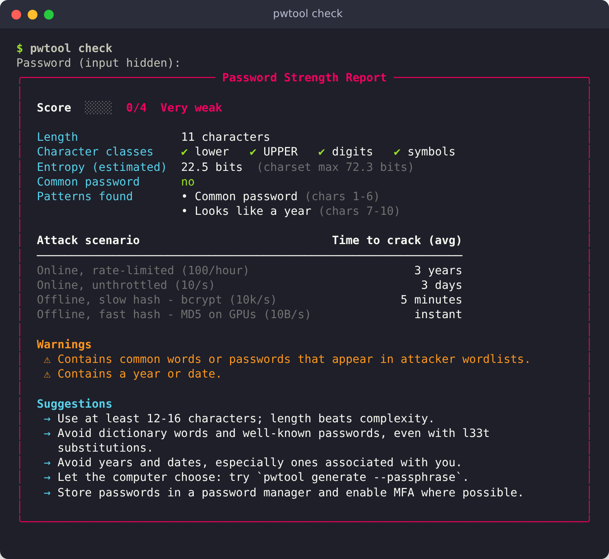
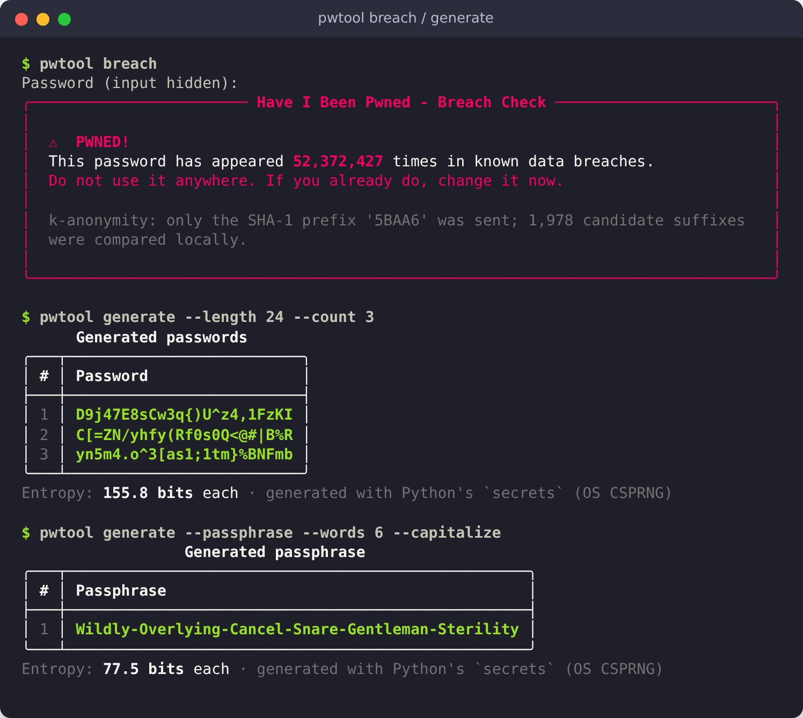

<div align="center">

# 🔐 Password Security Toolkit

**A privacy-first command-line toolkit to analyse password strength, check passwords against
known data breaches, and generate cryptographically secure passwords and passphrases.**

[](https://www.python.org/)
[](LICENSE)
[](#-running-tests)
[](#-running-tests)
[](https://docs.astral.sh/ruff/)
[](https://mypy-lang.org/)
[](https://haveibeenpwned.com/Passwords)



</div>

---

## 📖 Overview

`pwtool` answers three questions every developer, sysadmin and security-minded user asks:

| Question | Command |
|----------|---------|
| *How strong is this password, really?* | `pwtool check` |
| *Has this password already leaked in a data breach?* | `pwtool breach` |
| *Can you give me a strong one instead?* | `pwtool generate` |

It is designed with security as a first-class requirement: passwords are read from a hidden
prompt (never from command-line arguments, so they don't land in your shell history), they are
never logged or written to disk, the reports never echo the password or any fragment of it,
and breach lookups use the **k-anonymity** model so your password never leaves your machine.

## ✨ Features

### `check` — strength analysis
- **Score 0–4** (*Very weak* → *Very strong*) with a colour-coded report.
- **Entropy estimate** that goes beyond naïve `length × log2(charset)`: predictable parts of
  the password are charged only the few bits an attacker actually needs (inspired by Dropbox's
  [zxcvbn](https://github.com/dropbox/zxcvbn)).
- **Character-class analysis** (lower, UPPER, digits, symbols, Unicode).
- **Common-password check** against a bundled list of the **10,000 most common passwords**,
  including **leetspeak** variants (`P@ssw0rd` → `password`).
- **Pattern detection:** dictionary words (EFF wordlist), keyboard walks (`qwerty`, `1qaz2wsx`,
  numpad), sequences (`abc`, `9876`), repeats (`aaaa`, `abcabc`), years and dates.
- **Crack-time estimates** for four attack scenarios, from rate-limited online attacks to
  GPU-powered offline attacks on fast hashes.
- **Actionable warnings and suggestions.**
- `--breach` to run a breach check in the same go, `--min-score N` for scripting / CI gates.

### `breach` — Have I Been Pwned lookup
- Uses the official [Pwned Passwords range API](https://haveibeenpwned.com/API/v3#PwnedPasswords)
  with **k-anonymity**: only the first **5 hex characters** of the SHA-1 hash are sent.
- Requests response **padding** (`Add-Padding: true`) so even the response size leaks nothing.
- Graceful handling of timeouts, DNS failures and HTTP errors, with automatic **retries and
  exponential backoff**.
- Meaningful exit codes: `0` not found, `1` pwned, `2` error.

### `generate` — secure generation
- Passwords from Python's [`secrets`](https://docs.python.org/3/library/secrets.html) module
  (the OS CSPRNG) — never `random`.
- Guarantees at least one character from every enabled class; options for length, count,
  `--no-symbols`, `--no-digits`, `--no-upper`, `--exclude-ambiguous`.
- **Diceware-style passphrases** from the bundled [EFF large wordlist](https://www.eff.org/dice)
  (7,772 words ≈ 12.9 bits/word) with custom separator, capitalisation and an optional digit.
- Entropy shown for every batch.

### Everywhere
- Beautiful terminal output powered by [Rich](https://github.com/Textualize/rich).
- `--json` on every command for scripting and automation; `--no-color` (and `NO_COLOR`) support.
- `--stdin` to pipe a password from a password manager, e.g. `pass show github | pwtool check --stdin`.
- Fully typed (`mypy --strict`), documented, `src/` layout, zero network access except the
  explicit breach check.

## 🛡️ Security notes

### How k-anonymity protects you

```
 your machine                                             api.pwnedpasswords.com
 ────────────                                             ──────────────────────
 password ──SHA-1──► 5BAA61E4C9B93F3F0682250B6CF8331B7EE68FD8
                     └─┬─┘└──────────────┬──────────────┘
                    prefix          suffix (kept local)
                       │
                       └──────── GET /range/5BAA6 ─────────────►
                                                                  returns ~800-1,000 suffixes
                       ◄──────── 0018A45C4D1DEF81644B54AB7F969B88D65:10 ─  sharing that prefix
                                 00D4F6E8FA6EECAD2A3AA415EEC418D38EC:2      (+ padding decoys)
                                 1E4C9B93F3F0682250B6CF8331B7EE68FD8:52372427
                                 ...
 suffix compared locally ──► match found → "PWNED 52,372,427 times"
```

1. The password is hashed **locally** with SHA-1 (the format of the HIBP dataset).
2. Only the **first 5 characters** of the 40-character hash are sent. Roughly a million
   different hashes share any given prefix, so the API cannot know which one you hold.
3. The API returns every suffix with that prefix; the comparison happens on your machine.
4. With `Add-Padding: true` the response is padded with fake entries, so its size does not
   reveal anything either.

The code enforces this: `fetch_range()` refuses to send anything that isn't exactly five
upper-case hex characters, and the test-suite asserts that neither the password nor the hash
suffix is ever passed to the network layer.

### Your password is never logged or stored
- **No CLI arguments:** passwords are read with `getpass` (hidden input) or from `--stdin`, so
  they never appear in shell history or in `ps` output.
- **No persistence:** nothing is written to disk; there is no config file, cache or log.
- **No echo:** reports describe *where* patterns are (`chars 1-6`), never *what* they are —
  so output is safe to paste into a ticket or a CI log. (Generated passwords are, of course,
  printed — that's the point of `generate`.)
- **No telemetry:** the only network request the tool can make is the explicit breach check.

> ⚠️ **Disclaimer:** strength estimates are heuristics. A high score is not a guarantee —
> always use a unique password per site, a password manager, and multi-factor authentication.

## 📦 Installation

Requires **Python 3.10+**.

```bash
# Install straight from GitHub
pip install "git+https://github.com/Josephobaje/password-security-toolkit.git"

# …or as an isolated CLI app
pipx install "git+https://github.com/Josephobaje/password-security-toolkit.git"
```

From source (for development):

```bash
git clone https://github.com/Josephobaje/password-security-toolkit.git
cd password-security-toolkit
python -m venv .venv && source .venv/bin/activate   # Windows: .venv\Scripts\activate
pip install -e ".[dev]"
pwtool --version
```

`python -m pwtool …` works as well as the `pwtool` entry point.

## 🚀 Usage

```text
$ pwtool --help
usage: pwtool [-h] [-V] COMMAND ...

Password Security Toolkit - analyse strength, check breaches with HIBP
k-anonymity, and generate secure passwords.

positional arguments:
  COMMAND
    check           analyse password strength (score 0-4)
    breach          check a password against Have I Been Pwned (k-anonymity)
    generate (gen)  generate secure passwords or passphrases

Passwords are never accepted as command-line arguments, logged, or stored.
```

### Check password strength

```text
$ pwtool check
Password (input hidden):
╭────────────────────────── Password Strength Report ──────────────────────────╮
│                                                                              │
│  Score  ████  4/4  Very strong                                               │
│                                                                              │
│  Length               16 characters                                          │
│  Character classes    ✔ lower   ✔ UPPER   ✔ digits   ✔ symbols               │
│  Entropy (estimated)  105.1 bits  (charset max 105.1 bits)                   │
│  Common password      no                                                     │
│  Patterns found       none                                                   │
│                                                                              │
│  Attack scenario                                Time to crack (avg)          │
│  ──────────────────────────────────────────────────────────────────          │
│  Online, rate-limited (100/hour)            longer than 100,000 years        │
│  Online, unthrottled (10/s)                 longer than 100,000 years        │
│  Offline, slow hash - bcrypt (10k/s)        longer than 100,000 years        │
│  Offline, fast hash - MD5 on GPUs (10B/s)   longer than 100,000 years        │
│                                                                              │
╰──────────────────────────────────────────────────────────────────────────────╯
```

A weak password such as `Summer2024!` gets a detailed breakdown (see the screenshot at the
top): score **0/4**, a *common password* and a *year* detected, ~22 bits of real entropy
instead of the 72 bits its length and character mix suggest, and concrete suggestions.

Useful options:

```bash
pwtool check --breach            # strength analysis + HIBP breach check
pwtool check --json              # machine-readable report
pwtool check --min-score 3       # exit 1 if the score is below 3 (great for scripts)
pass show email | pwtool check --stdin
```

<details>
<summary>Sample <code>--json</code> output</summary>

```json
{
  "score": 0,
  "max_score": 4,
  "label": "Very weak",
  "length": 10,
  "character_classes": {"lowercase": true, "uppercase": false, "digits": true, "symbols": false, "other": false},
  "charset_size": 36,
  "charset_entropy_bits": 51.7,
  "estimated_entropy_bits": 10.97,
  "is_common_password": false,
  "common_password_rank": null,
  "patterns": [
    {"kind": "dictionary", "start": 0, "end": 6, "length": 6, "bits": 2.32, "description": "Common password"},
    {"kind": "date", "start": 6, "end": 10, "length": 4, "bits": 7.64, "description": "Looks like a year"}
  ],
  "crack_time_seconds": {"online_throttled": 36000.0, "online_unthrottled": 100.0, "offline_slow_hash": 0.1, "offline_fast_hash": 1e-07},
  "crack_time_display": {"online_throttled": "10 hours", "online_unthrottled": "2 minutes", "offline_slow_hash": "instant", "offline_fast_hash": "instant"},
  "warnings": ["Contains common words or passwords that appear in attacker wordlists.", "Contains a year or date."],
  "suggestions": ["Use at least 12-16 characters; length beats complexity.", "..."]
}
```

</details>

### Check for breaches



```text
$ pwtool breach
Password (input hidden):
╭───────────────────── Have I Been Pwned - Breach Check ───────────────────────╮
│                                                                              │
│  ✔  Good news!                                                               │
│  This password was not found in the Pwned Passwords corpus.                  │
│  Not being breached does not make it strong - run `pwtool check` too.        │
│                                                                              │
│  k-anonymity: only the SHA-1 prefix '948AF' was sent; 1,990 candidate        │
│  suffixes were compared locally.                                             │
│                                                                              │
╰──────────────────────────────────────────────────────────────────────────────╯
```

```bash
pwtool breach --json             # {"pwned": true, "count": 52372427, "hash_prefix_sent": "5BAA6", ...}
pwtool breach --timeout 5        # custom network timeout (seconds)
```

### Generate passwords and passphrases

```text
$ pwtool generate --length 24 --count 3
      Generated passwords
╭───┬──────────────────────────╮
│ # │ Password                 │
├───┼──────────────────────────┤
│ 1 │ inb};)>~04}Au/{rGrDx?vtr │
│ 2 │ z@6N>H}X]X6Gc6g@5-oU[0.F │
│ 3 │ YBgYWwO$i^T2@$RS18lI>Ar6 │
╰───┴──────────────────────────╯
Entropy: 155.8 bits each · generated with Python's `secrets` (OS CSPRNG)

$ pwtool generate --passphrase --words 5 --separator " "
            Generated passphrase
╭───┬────────────────────────────────────────────╮
│ # │ Passphrase                                 │
├───┼────────────────────────────────────────────┤
│ 1 │ spearfish distance drilling caregiver folk │
╰───┴────────────────────────────────────────────╯
Entropy: 64.6 bits each · generated with Python's `secrets` (OS CSPRNG)
```

| Option | Description |
|--------|-------------|
| `-l, --length N` | password length (default 20) |
| `-n, --count N` | number of passwords/passphrases (default 1) |
| `--no-symbols` / `--no-digits` / `--no-upper` | restrict the alphabet |
| `--exclude-ambiguous` | drop look-alikes such as `l 1 I O 0` |
| `-p, --passphrase` | Diceware-style passphrase mode |
| `-w, --words N` | words per passphrase (default 6 ≈ 77.5 bits) |
| `-s, --separator S` | word separator (default `-`) |
| `--capitalize`, `--add-number` | passphrase variations |
| `--json` | JSON output |

### Exit codes

| Code | Meaning |
|------|---------|
| `0` | success / password not found in breaches |
| `1` | password **pwned** (`breach`), or score below `--min-score` (`check`) |
| `2` | error (bad input, network failure) |
| `130` | interrupted with Ctrl+C |

### Use it as a library

```python
from pwtool import analyze, check_pwned, generate_passphrase

report = analyze("correct horse battery staple")
print(report.score, report.label, round(report.entropy, 1))  # 3 Strong 67.2

result = check_pwned("hunter2")  # k-anonymity under the hood
print(result.pwned, result.count)

print(generate_passphrase(6, capitalize=True))
```

## 🗂️ Project structure

```
password-security-toolkit/
├── src/pwtool/
│   ├── __init__.py          # public API & version
│   ├── __main__.py          # `python -m pwtool`
│   ├── cli.py               # argparse CLI, secure input, exit codes
│   ├── strength.py          # scoring, entropy, crack times, feedback
│   ├── patterns.py          # dictionary/leet, keyboard, sequence, repeat, date detectors
│   ├── breach.py            # HIBP Pwned Passwords client (k-anonymity)
│   ├── generator.py         # CSPRNG password & passphrase generation
│   ├── output.py            # Rich rendering + JSON output
│   ├── wordlists.py         # loading of bundled data
│   ├── py.typed
│   └── data/
│       ├── common_passwords.txt     # 10k most common passwords (SecLists, MIT)
│       ├── eff_large_wordlist.txt   # EFF passphrase wordlist (CC BY 3.0 US)
│       └── NOTICE.md
├── tests/                   # pytest suite (network fully mocked)
├── docs/images/             # screenshots
├── pyproject.toml           # packaging, ruff, mypy, pytest & coverage config
├── CHANGELOG.md
└── LICENSE
```

## 🧪 Running tests

```bash
pip install -e ".[dev]"

pytest --cov=pwtool          # 143 tests, 99% branch coverage
ruff check . && ruff format --check .
mypy                         # strict mode
```

The Have I Been Pwned API is **always mocked** in tests — an autouse fixture makes any real
network call fail the test — so the suite is fast, deterministic and works offline.

```text
Name                      Stmts   Miss Branch BrPart  Cover
-----------------------------------------------------------
src/pwtool/breach.py         71      0     14      0   100%
src/pwtool/cli.py           134      0     28      0   100%
src/pwtool/generator.py      79      0     22      1    99%
src/pwtool/output.py         76      0     16      0   100%
src/pwtool/patterns.py      152      0     58      0   100%
src/pwtool/strength.py      134      0     34      0   100%
...
TOTAL                       672      0    174      1    99%
143 passed
```

## 🗺️ Roadmap

- [ ] Batch audit mode: analyse a file of password hashes / a password-manager CSV export locally
- [ ] Optional offline breach checks against a downloaded HIBP hash dataset
- [ ] Localised wordlists and keyboard layouts (AZERTY, QWERTZ, Dvorak)
- [ ] Better scoring for name/date/personal-info patterns (with user-supplied context)
- [ ] TOTP / MFA secret generator
- [ ] Publish to PyPI and add shell completions
- [ ] GitHub Actions CI matrix (3.10 – 3.13) with coverage badge

Ideas and pull requests are welcome — open an issue to discuss.

## 📄 License

Released under the [MIT License](LICENSE) © 2026 Joseph Obaje.

Bundled data: the common-password list comes from [SecLists](https://github.com/danielmiessler/SecLists)
(MIT) and the passphrase wordlist from the [EFF](https://www.eff.org/dice) (CC BY 3.0 US).
Breach data is provided by [Have I Been Pwned](https://haveibeenpwned.com/) by Troy Hunt;
this project is not affiliated with HIBP.

## 👤 Author

**Joseph Obaje** — Full-stack, Flutter & Python developer with a focus on cybersecurity.

- GitHub: [@Josephobaje](https://github.com/Josephobaje)
- LinkedIn: [joseph-obaje](https://www.linkedin.com/in/joseph-obaje)

If you find this project useful, please consider giving it a ⭐!
